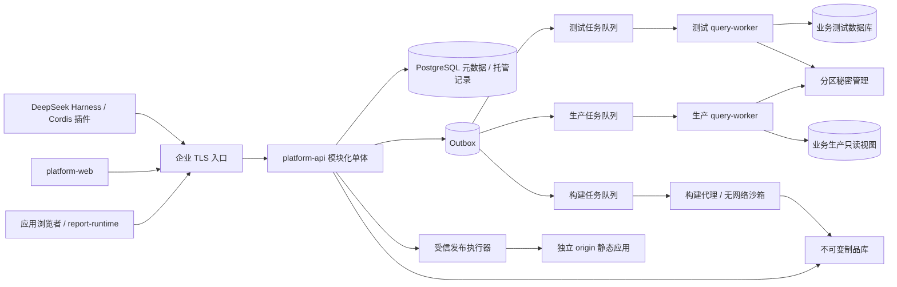
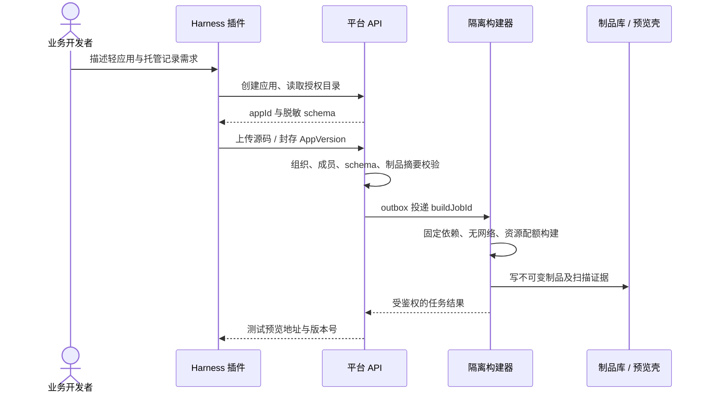
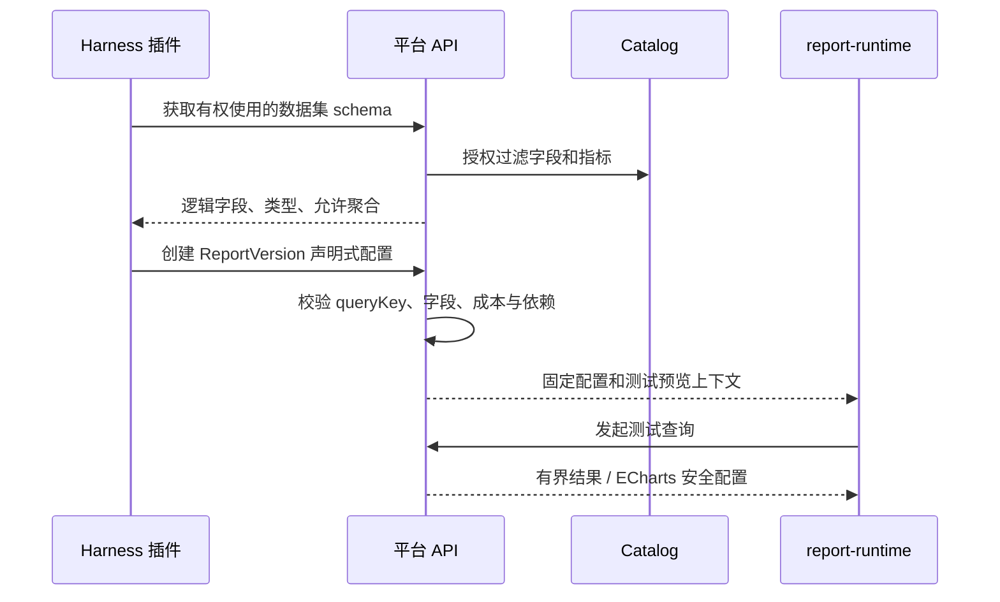
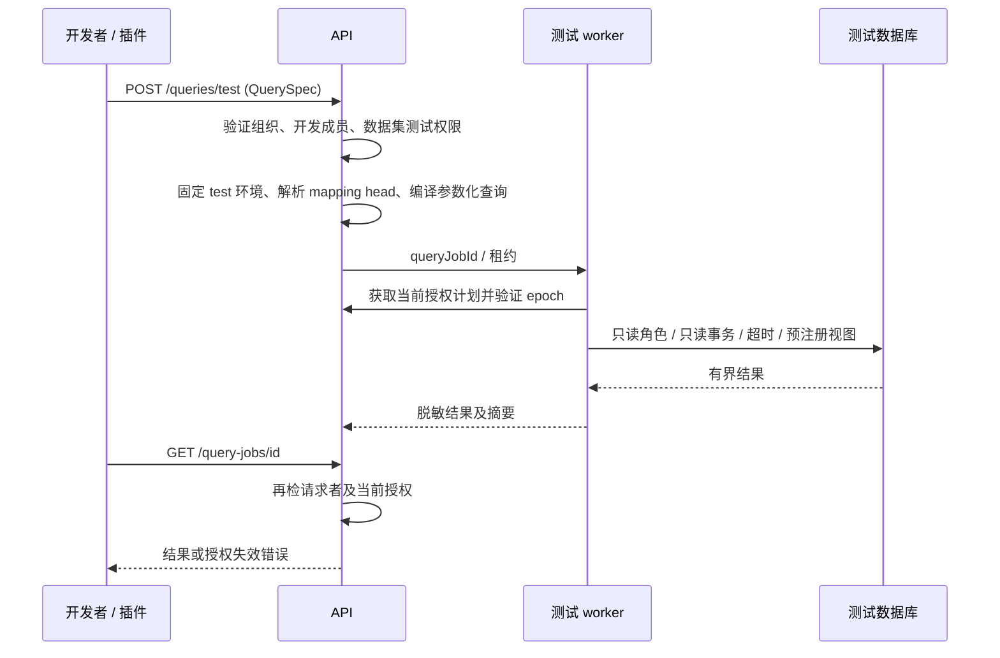
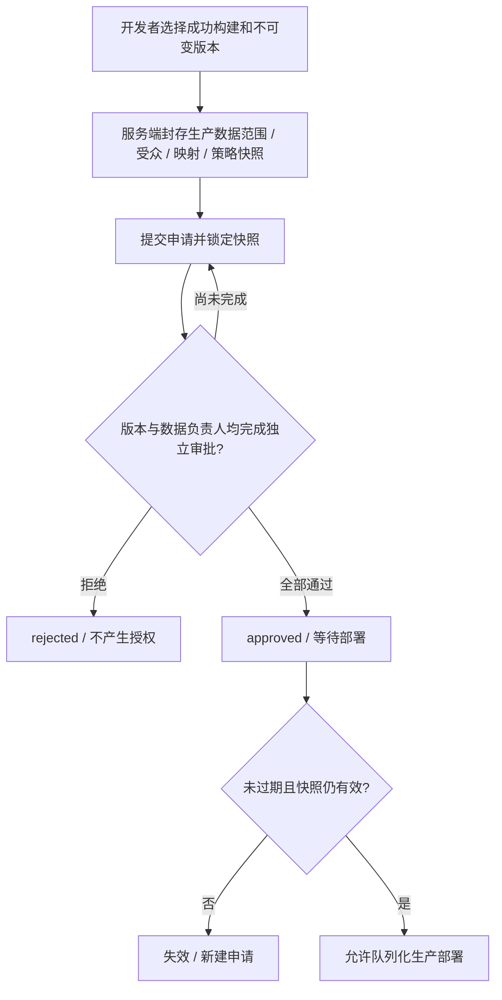
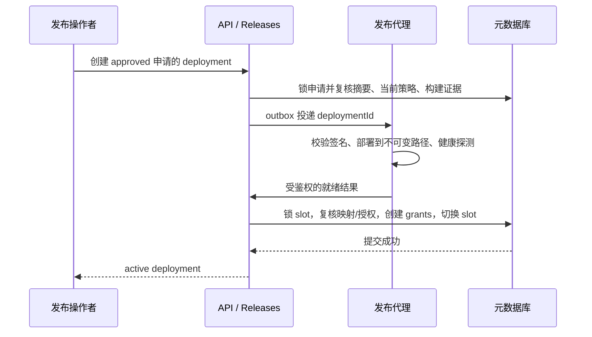
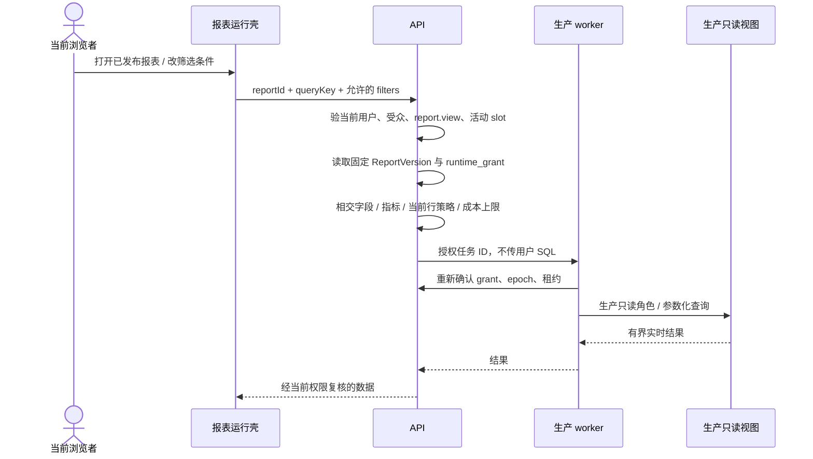
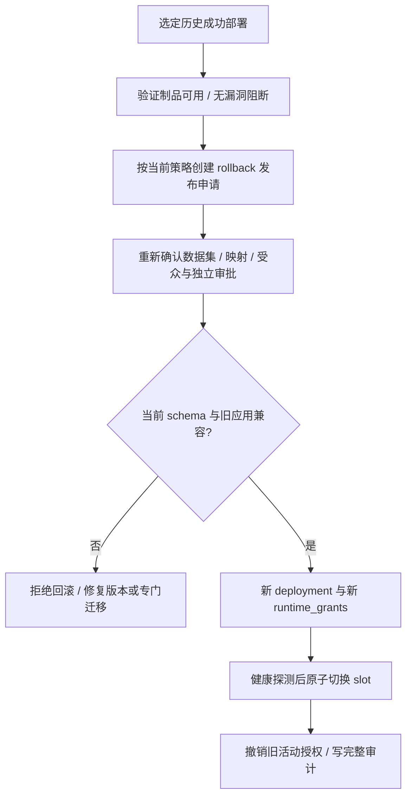

> 阶段06实现更新：顺序审批、冻结清单、受控静态部署、生产授权与重新审批回滚见 [上线发布说明](releases-guide.md)、[验证范围](stage06-validation.md) 和 ADR0021。下文旧阶段记录保留为历史，当前实现以这些说明和 OpenAPI 为准。

> 当前阶段04/05说明：[报表与源码预览](reports-guide.md)、[Harness插件](harness-plugin.md)。以最后确认的源码生成流程为准：Harness生成完整React代码，插件桥接，平台不增加AI模型生成服务。Studio通过QueryGateway公开端口校验语义和创建TEST任务；独立固定编译worker不执行上传脚本。所有编译产物preview_only，正式构建沙箱/审批/生产授权签发尚未启用。

## 阶段04/05实际模块协作

~~~mermaid
sequenceDiagram
 participant H as Harness AI + 原生代码工具
 participant P as Cordis企业插件
 participant A as Studio应用服务
 participant B as 独立固定编译worker
 participant W as 受信门户 + opaque iframe
 participant Q as QueryGateway
 H->>P: 获取授权语义并提交工作区源码
 P->>A: 当前用户Token，源码文件与manifest
 A->>Q: 校验当前用户、数据集、字段、指标与TEST策略
 A->>A: 不可变源码/报表/绑定，追加版本
 A->>B: 签名请求，仅允许源码+固定profile
 B-->>A: 编译产物（不运行源码/包脚本）
 A-->>W: 鉴权后的TEST产物，当前版本manifest
 W->>A: iframe只传queryKey和筛选，Token留在受信壳
 A->>Q: 当前访问用户再授权，固定TEST
 Q-->>W: 实际数据库查询结果
~~~

当前artifact bytea仓储有8MiB上限和RLS；不是企业对象存储替代验收。业务接口和版本恢复见reports-guide；安装版本研究与官方API差异见harness-plugin。下文阶段00/02/03保留为设计历史。

## 阶段03统一执行链

~~~mermaid
sequenceDiagram
 participant U as 用户/AI/管理台
 participant G as QueryGateway
 participant M as 元数据库
 participant W as 独立环境connector
 participant D as 批准的测试/生产库
 U->>G: DSL与用户token（无环境/SQL/host）
 G->>M: 当前角色、字段、行策略；运行入口另验审批/发布
 G->>M: 事务保存query_job与授权摘要/审计
 G-->>U: 202 + job/trace ID
 G->>W: 签名任务ID
 W->>G: mTLS领取短租约，再鉴权
 G-->>W: 固定连接与授权计划
 W->>D: READ ONLY + RLS上下文 + EXPLAIN
 W->>D: 参数化SQL + SQL侧脱敏 + 流式结果上限
 W-->>G: 签名安全结果
 G->>M: 当前授权再次核对，再保存结果/审计
 U->>G: 读取自己的job（再次鉴权）
 G-->>U: 受限结果；撤权则拒绝
~~~


> 阶段 02 实现更新（2026-10-23）：以下原阶段00设计继续作为全平台基线。数据源模块已实现；其实际边界与运行方式以 [catalog-guide](catalog-guide.md)、ADR0007/0008 和验证记录为准。其他业务仍为设计。

## 阶段02实际运行结构

~~~mermaid
flowchart LR
  Web[React 管理台 / access token] --> API[NestJS Fastify 控制面]
  API --> Meta[(元数据库 / eas_api + RLS)]
  API -->|固定 TEST 任务 ID / 签名 + mTLS| Test[TEST connector]
  API -->|独立生产权限 / 签名 + mTLS| Prod[PROD connector]
  Test -->|批准 CIDR + SELECT 最小权限| TestDB[(测试业务库)]
  Prod -->|仅健康或定向结构读取| ProdDB[(生产业务库)]
  Test --> Vault[环境范围秘密提供器]
  Prod --> Vault
~~~

共10个workspace包。新增 database-adapters 与 connector-transport；API不依赖业务驱动，worker不导入API实现。控制面 Catalog、Identity 与 Releases invalidation 通过应用服务端口交互。生产报表/应用查询和审批流程仍未实现，不能从上图推导其可用。开发查询永远选择TEST。

数据集语义为受限字段/聚合/参数化过滤，首版只查询一个批准对象；关系描述用于语义目录，不自动JOIN。异步任务使用元数据库持久队列而非Redis，详情见ADR0008。

# Enterprise AI Studio 技术架构

版本：0.0.0 · 设计基线：2026-10-22 · 部署范围：企业内网

## 1. 系统定位与交付范围

Enterprise AI Studio 是企业内部的应用与报表控制平台。DeepSeek Harness 提供人与 AI 协作入口，Cordis 插件通过受鉴权的 REST API 操作平台。独立后端维护资源、版本、数据目录、审批及部署事实，数据库和执行器均不直接暴露给 AI 客户端。

业务开发访问测试源；生产数据访问须在上线申请通过后，由平台对具体部署授予受限读取能力。“连接生产”指生产查询 worker 以专用只读身份访问经批准的物理连接，生成网页、插件和开发者不取得连接串或数据库会话。测试源由企业数据负责人提供合成或脱敏数据，保持批准的视图结构；测试源不可用时拒绝查询，不回退生产。

首个业务版本支持 React 静态轻应用、声明式报表、平台托管表单记录与受控 CRUD。生成应用不携带任意 Node.js 后端，不允许运行用户 SQL 或向业务生产库写入；确需外部业务写操作时，以单独受审的企业服务连接器扩展。平台托管记录与数据源报表读取采用不同权限域。

阶段 00 交付技术设计、OpenAPI、可执行参考 DDL、工作区配置、构建链、健康检查、关闭执行的 worker 和 Cordis 生命周期骨架。OIDC、审批、查询、实际沙箱、任务消费者和业务页面尚未实现。所有设计中的服务端规则必须在后续阶段落实，不能因文档存在即视为已经防护。

## 2. 技术选择及取舍

| 领域 | 选择 | 原因 | 替代方案及代价 |
| --- | --- | --- | --- |
| 管理与运行界面 | React 19、TypeScript 5.9、Vite 8 | 类型共享；内网应用无 SEO 要求；静态产物便于摘要固定与独立域托管 | Next.js 提供 SSR，但扩大生成代码的服务器执行面；Vue 可行但需另一套客户端组件栈 |
| 控制平面 | NestJS 12 + Fastify 5 adapter | Module/DI/Guard/Interceptor 约束团队分工；Fastify 负责 HTTP 管线 | 纯 Fastify 更轻，但领域依赖与授权约定需自建；Express 中间件更多，需避免依赖其专用 API |
| 元数据和托管业务记录 | PostgreSQL 18 | 事务、外键、JSONB、审计查询；发布事实可在同一事务提交 | MySQL 也可用，但迁移 SQL、JSON 和 RLS 设计成本上升；不选最终一致的文档库承载审批事实 |
| 数据访问 | 参数化 SQL + pg；正式迁移显式 SQL | 复合外键、部分索引和锁语义可审阅；域仓储封装访问 | Prisma/Drizzle 提升生成效率，但必须保留关键原生约束；阶段 00 无 ORM 运行依赖 |
| 队列和短缓存 | Redis 7.4；后续 BullMQ | 有界任务、限流和缓存成熟；任务真相仍在 PostgreSQL | RabbitMQ 适合复杂消息路由；Valkey 可按企业采购和运维标准替换，需做队列兼容验证 |
| 报表 | ECharts 6 + 受控配置编译器 | 常用图表覆盖广；本地打包，无公网 CDN | Vega-Lite 的语法更统一但需培训；直接放开 ECharts formatter 函数会引入脚本执行风险 |
| 契约 | OpenAPI 3.1.1 + openapi-typescript | 参数、响应、鉴权扩展及类型同源；兼容现有校验工具链 | 3.2 新能力目前无需求；GraphQL 不利于固定生产查询成本和审批范围 |
| 工程 | pnpm workspace；Node.js 24 | 同一锁文件、拓扑构建、低重复依赖；采用已有 LTS 线 | Nx/Turborepo 可在构建耗时增长后引入，当前 8 个包无需调度框架 |
| 部署 | Docker Compose 开发；专用 Linux 执行主机 | 本地依赖可复现；低并发首期便于企业运维 | Kubernetes 适合池化弹性和多机高可用，首期运维成本高；Compose 不承担代码隔离保证 |
| 代码隔离 | gVisor 沙箱或 microVM；独立构建主机 | 不可信构建与控制面隔离，限制内核和网络攻击面 | 普通容器边界不足；进程内 vm、worker_threads 不是恶意代码安全边界 |
| 身份与秘密 | 企业 OIDC；Vault/KMS；内部 mTLS | 统一账号停用、短会话、秘密轮换和工作负载身份 | 本地账号扩大口令生命周期成本；开发 .env 仅供本机 |
| 文件与制品 | 企业 S3 兼容对象存储 + 内部 OCI 仓库 | 不可变 artifact digest、短时上传及扫描证据 | 单机磁盘适合演示但不支持可靠备份和跨节点发布 |
| AI 接入 | DeepSeek Harness Cordis 插件 | 原生 apply/inject 生命周期；业务后端独立于模型与客户端 | MCP 可作为后续兼容层；直接让插件连接数据库会破坏授权边界 |

基础包版本在 `pnpm-lock.yaml` 中精确锁定。Node 24 补丁升级由企业基线管理，不把当前开发机补丁版本视为长期安全版本。Harness 官方仍标注 developer preview，插件接口必须固定发布版本并进行实际宿主加载测试，不能仅依赖 master 文档。

技术事实参考：[Nest Fastify adapter](https://docs.nestjs.com/techniques/performance)、[React 构建选择](https://react.dev/learn/creating-a-react-app)、[ECharts 起步](https://echarts.apache.org/handbook/en/get-started/)、[OpenAPI 3.1.1](https://spec.openapis.org/oas/v3.1.1.html)、[Node 发布计划](https://github.com/nodejs/Release)、[Harness 官方说明](https://www.deepseek.com/harness/en/)、[Cordis 扩展入口](https://github.com/deepseek-ai/deepseek-harness/blob/master/docs/cookbook/extension-cookbook.md)。技术组合与边界是本项目的架构决策。

## 3. 逻辑架构与信任边界



控制面不运行上传代码、不连接业务数据库、不持有生产库口令。查询 worker 只执行平台编译的查询，不执行生成程序；构建 worker 只能读取源码及固定依赖缓存，无元数据库、秘密管理或数据源访问权。生产/测试 worker 即使共用同一代码包，也使用独立部署、网络和身份。消息队列只负责投递，不能决定环境或授权。

静态生成应用使用独立站点 origin。管理后台 cookie、OIDC token 不注入生成页面。平台维护宿主壳；受信壳通过受限消息协议代理查询，逐次确认 event.origin/source、活动部署及 JSON Schema，生成页面不能指定 API URL、HTTP 方法或转发 Authorization header。初期可采用 sandbox iframe 与壳端代理；允许脚本但禁止 top navigation、弹窗及任意外网连接。CSP、浏览器隔离和代理校验需联合测试，不能用 iframe 取代服务端权限。

## 4. 代码结构与依赖

```text
apps/
  platform-web/          # 受信管理界面，应用/目录/审批工作台
  platform-api/          # 统一控制面，src/modules/boundaries.ts 记录域归属
  report-runtime/        # 受信声明式渲染端，ECharts 图表编译与查询代理
packages/
  shared/                # 无副作用值类型和常量
  api-contract/          # openapi.json、生成类型、公共 DTO 入口
  harness-plugin/        # Cordis apply，用户身份桥接与 REST 工具适配
services/
  query-worker/          # 同源代码、测试/生产分离部署的受控查询执行器
  build-worker/          # 构建任务代理边界；实际源码在下级沙箱执行
infra/                   # 开发 Compose、API Dockerfile、生产边界说明
scripts/                 # 契约生成、边界检查、参考 DDL 验证、开发环境初始化
tests/                   # 骨架与拒绝行为验证
docs/adr/                # 关键决策及变更依据
```

编译依赖只能从各应用/worker/plugin 指向 shared 和 api-contract，后两者不反向引用实现；shared 不依赖 api-contract。包间使用 workspace 包名，禁止跨目录相对导入。运行时插件和前端通过 REST；worker 通过独立内部任务协议、工作负载身份和租约交互，不依赖 API 进程内单例。内部协议不暴露公网；下一阶段按任务能力定义独立契约和身份受众。

| API 领域模块 | 拥有的数据与职责 | 允许调用的能力 |
| --- | --- | --- |
| Identity | 用户、组织、角色、资源授权、策略 epoch | 企业 OIDC，审计 |
| Applications | 应用、成员、源码版本、托管集合 schema、构建请求 | 文件服务、授权、outbox |
| Catalog | 逻辑源、物理连接、映射、数据集与指标 | 管理端注册清单、连接探测任务 |
| Reports | 声明式报表与不可变版本、数据集依赖 | Catalog 只读目录、权限服务 |
| Releases | 申请、独立审批、部署、运行授权、回滚 | 版本摘要、权限服务、发布代理 |
| Queries | 授权决策、查询编译、任务与结果生命周期 | Catalog、Releases、独立 query-worker |
| ApplicationData | 平台托管记录、schema 校验、行归属 | 版本 schema、当前访问者与审计 |
| Audit / Infrastructure | 审计、幂等、outbox、对象存储 | 提供基础端口，不越权作业务决策 |

Identity 提供显式 `authorize(subject, action, resource)`，其他域不读取角色表拼装旁路；Catalog 不发布应用；Releases 不自行扩大数据集授权；ApplicationData 不执行用户定义的 SQL/函数。不存在前端直连 PostgreSQL 或 worker 接受客户端 DSN 的路径。

## 5. 关键状态、事务与一致性

- 应用、数据集、报表版本封存后不可改写；元数据修订使用 revision/ETag。构建请求与状态独立，成功构建绑定源码、模板、锁文件及产物摘要。
- 发布申请：draft → submitted → approved / rejected；draft、submitted 可 cancelled；未消费的 submitted/approved 可 expired。submitted 后快照不变，更改受众或权限范围要创建新申请。approved 不等于已经发布。
- 部署：queued → validating → deploying → active；失败进入 failed；切换成功后原 active 进入 superseded。每个 app/environment 只有一个活动 slot，一次申请只产生一个部署。
- 同一 PostgreSQL 事务完成幂等占位、状态锁定、审批摘要复核、任务/授权事实与 outbox 写入。远程构建或数据查询不能持有控制面数据库事务。
- 发布代理先把不可变文件部署到未激活路径并验证摘要、路由健康；随后控制面事务锁住 app slot，复核 policy epoch 和映射，创建 runtime_grants 并切换 slot。宿主壳只按控制面 slot 返回激活版本；不依赖反向代理配置与数据库原子提交。
- 静态文件上传失败保留旧 slot。数据库提交后 worker 重试以 deploymentId 收敛。租约超时的 validating/deploying 由协调器确认外部实际结果后恢复或标记失败；不在结果未知时自动重复副作用。恢复任务使用租约、attempt、唯一约束和比较交换。
- 回滚创建新申请和新 deployment，复用历史制品，不重新执行旧源码；重新验证当前受众、映射、schema、策略和漏洞状态。托管业务数据不随静态版本回滚，schema 只能采用兼容扩展；破坏性变更需要独立数据迁移方案。

## 6. 关键业务流程

### 6.1 AI 创建业务网站



预览读取测试数据；没有审批动作不会创建生产授权。预览壳为后续业务实现，本阶段只构建界面骨架。

### 6.2 AI 生成报表



报表不接受任意 HTML、JavaScript formatter 或 SQL；新报表版本必须进入新的 AppVersion 才能生产发布。

### 6.3 测试数据源查询



### 6.4 上线申请与审批



审批人身份来自交互式企业登录和新鲜的强化认证，插件服务身份无审批权限。一个人是否能同时覆盖不同数据负责人角色由固定审批策略决定；最少一位审批人必须与申请人不同。所有要求均来自服务端策略快照。

### 6.5 生产授权与发布



### 6.6 已发布报表实时查询



“实时”指用户触发时读取当前源数据；默认结果缓存最多 15 秒，可为敏感数据禁用。它不是数据库变更流订阅。访问者无需获得开发者的测试查询权限，但必须获得显式生产报表访问权限；所有行策略按当前访问者求值。

### 6.7 应用回滚



## 7. 性能、可靠性和运维目标

首期容量假设：200 名注册用户、50 名并发管理用户、20 个并发数据查询、100 个应用。元数据 API 目标 P95 < 300 ms，查询排队外执行时间上限 10 s、最多 1000 行 / 2 MiB；构建上限 120 s、2 CPU、1 GiB、100 MiB 展开源码。以上是测试验收目标，需要企业环境压测证明。

按用户/组织/数据源三层限流；每源初始最大并发 4，生产账号连接池上限 8，避免报表拖垮业务库。查询超时必须发送数据库取消并终止租约；丢失消费者不能无限占用连接。未实现取消前不得开放生产查询。

Redis 丢失可从 outbox 与任务表恢复，不能丢审批事实。元数据库计划 RPO ≤ 15 min、RTO ≤ 4 h，采用 WAL 归档和定期恢复演练；对象存储保留与审批/回滚保留期一致。审计在线保留 180 天、归档 1 年，企业政策可延长。结果对象默认 5 分钟到期，不存入永久应用制品。

所有流程传播 requestId/jobId/deploymentId；指标包含队列积压、拒绝率、生产查询耗时、撤销延迟、构建失败、部署卡住。日志不记录 SQL 参数、原始行数据、token 或 secretRef。元数据库不可用、授权服务异常、映射未知和证据缺失统一拒绝生产执行。
> 2026-10-24新增独立preview-worker：控制面绑定当前用户与不可变TEST构建，浏览器端执行和截图位于独立进程；实时数据继续经原查询网关。实际流程和未验收范围见[远程调试](remote-debugging.md)。

