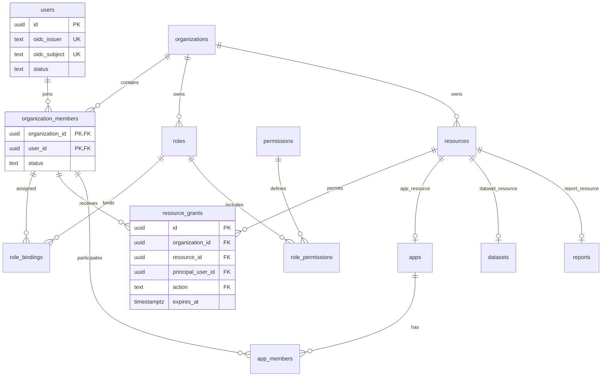
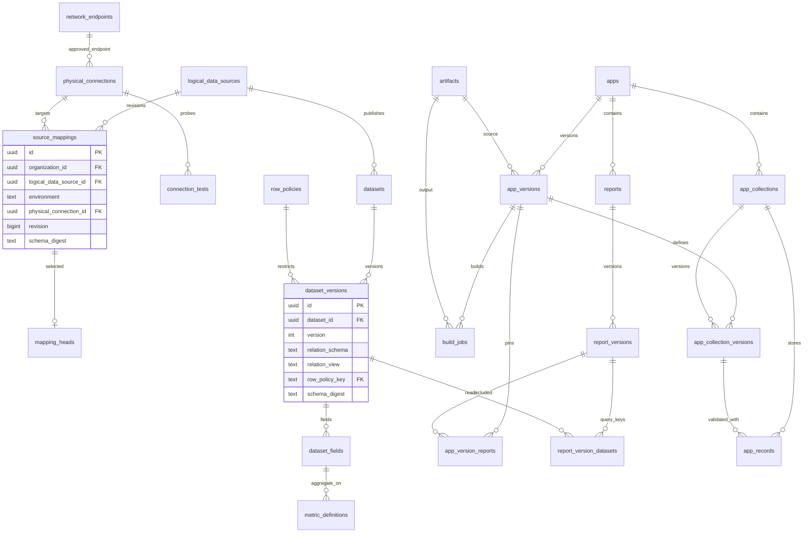
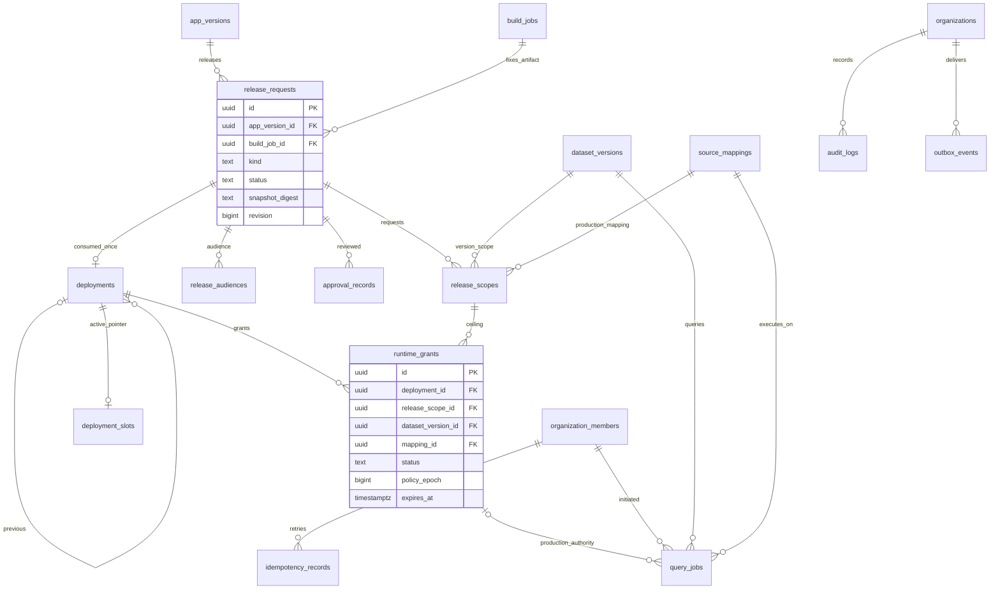

> 阶段06实现更新：顺序审批、冻结清单、受控静态部署、生产授权与重新审批回滚见 [上线发布说明](releases-guide.md)、[验证范围](stage06-validation.md) 和 ADR0021。下文旧阶段记录保留为历史，当前实现以这些说明和 OpenAPI 为准。

> 阶段03：0003_query_gateway.sql在原47表上新增query_policies、query_policy_heads、query_audits，总50表（另有迁移账本）。原query_jobs开始实际使用：TEST不再强制app_version_id，PROD仍必须有版本/部署/runtime_grant；新增固定连接、策略、用途、授权摘要、Trace ID、租约/attempt、受限结果与耗时。organization_members新增department_codes。

查询策略、row_policies、审计、应用/报表版本和批准scope/受众/审批记录有更新/删除拒绝触发器。发布事实对API只读；只有runtime_grants失效沿用既有UPDATE，API没有签发INSERT。新增组织表和被消费的发布表均FORCE RLS。查询审计不含过滤值/结果；query_jobs是受保护业务数据存储，有五分钟结果留存，不能当普通日志导出。

> 阶段02结构权威来源：infra/migrations/0001_baseline.sql + 0002_catalog.sql。原 docs/schema.sql 是43表阶段00参考基线；真实迁移后47表（另有迁移账本）。不应直接用参考DDL部署阶段02。

## 数据源模块落地实体

新增 credential_profiles、auth_sessions、catalog_jobs、metadata_snapshots。前者包含秘密引用与批准端点ID清单，仅管理员可读的API返回别名与类型；auth_sessions仅测试模式token hash；任务保存私有输入，公开DTO仅返回状态与安全结果；结构快照不可变。

~~~mermaid
erDiagram
  organizations ||--o{ network_endpoints : approves
  organizations ||--o{ credential_profiles : owns
  network_endpoints ||--o{ physical_connections : bounds
  credential_profiles ||--o{ physical_connections : authenticates
  logical_data_sources ||--o{ source_mappings : revises
  physical_connections ||--o{ source_mappings : maps
  source_mappings ||--o{ mapping_heads : selects
  physical_connections ||--o{ catalog_jobs : executes
  catalog_jobs ||--o| metadata_snapshots : produces
  metadata_snapshots ||--o{ dataset_versions : proves
  logical_data_sources ||--o{ datasets : groups
  datasets ||--o{ dataset_versions : versions
  dataset_versions ||--o{ dataset_fields : defines
  dataset_versions ||--o{ metric_definitions : defines
  resources ||--o{ resource_grants : authorizes
  users ||--o{ auth_sessions : authenticates
~~~

source_mappings、dataset_versions、dataset_fields、metric_definitions、metadata_snapshots有UPDATE/DELETE拒绝触发器；mapping_heads仅指向追加的映射。组织+资源+environment/engine复合外键防止连接错环境；source key组织唯一，数据集key组织唯一，版本(dataset_id,version)组织范围唯一。连接目标、engine和credential_profile创建后不可变。版本definition JSON保存关系与完整口径，同时物化字段和指标表以支撑后续查询。

索引 sources_list_idx 支持组织/状态/创建时间列表；catalog_jobs有状态/创建时间调度索引与组织外键；metadata_snapshots按连接+创建时间；resource_grants按主体/资源/动作/到期查询。详见迁移中的可执行索引与约束。47表中阶段02相关组织表启用FORCE RLS，运行角色不可绕过；其余阶段00参考表没有被宣称已具备完整业务实现。

禁止原地修改已应用迁移；迁移账本记录名称+SHA256，重复执行跳过相同内容，修改失败关闭。

# 数据库设计

## 1. 约定与权威来源

PostgreSQL 18 承载平台元数据与平台托管记录，业务测试/生产数据仍保留在企业业务数据库。`schema.sql` 是本阶段可执行的结构参考，包含 43 张表、主外键、CHECK、唯一约束及关键索引。它不是完整生产迁移：数据库角色、RLS、不可变更新触发器、权限种子及状态机需要在相应实现阶段补充并测试。

UUID 为主标识，数据库列 snake_case，API 字段 camelCase；`organization_id ↔ organizationId`，`app_version_id ↔ appVersionId`。身份由 `(oidc_issuer, oidc_subject)` 识别，邮箱不能作为不可变登录主键。时间使用 UTC timestamptz，在展示层转换时区；金额/精度值在业务 schema 中使用 decimal 字符串或规范化最小单位，不依赖 JavaScript 浮点。

除全局 users、permissions、organizations 外，各业务表必须带 organization_id。普通实体以 id 为 PK，并建立 `UNIQUE (organization_id, id)`，所有跨租户敏感关系使用复合外键。连接组织范围、RBAC、行策略仍须在后端检查；复合 FK 防止错误关联，不能替代读权限。

## 2. ER 图

### 2.1 身份与资源权限

users 中两个 UK 标记表示联合唯一，非分别唯一。resource kind 使用带固定 CHECK 的复合 FK，避免把 dataset 资源误挂到 app 实体。资源创建与实体创建在同一事务进行，失败整体回滚。

### 2.2 数据目录、应用与报表

### 2.3 审批、部署与查询

rollback_target_deployment_id 引用同一个 app 的历史部署；previous_deployment_id 记录切换时实际前驱。这两个关系用途不同，不能相互代替。query_jobs 的 test 任务必须没有 deployment/grant；production 任务必须具备两者。

## 3. 主要实体字典

各实体完整字段类型、NULL 与默认值以参考 SQL 为准，以下列出业务含义及关键关联。

| 实体 | 核心字段 / 关联 | 唯一约束与生命周期 |
| --- | --- | --- |
| users | oidc_issuer、oidc_subject、display_name、status | `(issuer, subject)`；停用代替删除 |
| organizations | key、name、revision、policy_epoch | key 全局唯一；epoch 控制缓存失效 |
| organization_members | organization_id、user_id、status | 复合 PK；组织内用户关联的 FK 目标 |
| permissions | key、description | action 字典 PK；只由受控迁移维护 |
| roles / role_permissions | 组织角色、permission_key | `(org,key)`；角色权限三列 PK |
| role_bindings | user_id、role_id | `(org,user,role)`；不能跨组织赋权 |
| resources | kind | 资源注册表；组织内实体与 kind 绑定 |
| resource_grants | principal_user_id、resource_id、action、expires_at | `(org,resource,principal,action)`；显式有效期 |
| artifacts | object_key、digest、kind、status、size_bytes、owner_user_id | `(org,object_key)`；sealed 后不可改写；隔离异常文件 |
| apps / app_members | key、owner_user_id、revision；member role | `(org,key)`；成员 PK `(org,app,user)` |
| app_versions | app_id、version、source_artifact_id、source_digest、manifest | `(org,app,version)`；封存后不可变 |
| build_jobs | app_version_id、status、template/lock_digest、artifact_id/digest、scan_status、attestation_ref | 成功必须有制品、扫描通过和签名证据引用；申请固定一次成功构建 |
| network_endpoints | environment、host、port、allowed_cidrs、tls_server_name | 管理员维护的网络清单；不能由 AI 创建 |
| physical_connections | environment、engine、endpoint_id、database_name、secret_ref、credential_revision | 与 endpoint 环境一致；API 不返回 secret_ref |
| connection_tests | physical_connection_id、status、failure_code | 探测不返回业务记录或原始驱动错误 |
| logical_data_sources | key、name | `(org,key)`；业务只选此逻辑身份 |
| source_mappings | logical_data_source_id、environment、revision、physical_connection_id、schema_digest | `(org,logical,env,revision)`；不可原地切换目标 |
| mapping_heads | logical_data_source_id、environment、mapping_id | PK `(org,logical,env)`；指向该源该环境的修订 |
| datasets | key、logical_data_source_id、revision | `(org,key)`；一个版本只读一个注册视图 |
| dataset_versions | version、relation_schema/view、row_policy_key、schema_digest | `(org,dataset,version)`；schema 与策略固定 |
| dataset_fields | dataset_version_id、key、physical_column、data_type、classification、filterable | PK `(org,dataset_version,key)` |
| metric_definitions | dataset_version_id、key、aggregate、field_key | 同版本指标唯一；field_key FK 指向同版本字段 |
| row_policies | key、definition、digest | PK `(org,key)`；key 包含修订；无可执行 JS/SQL |
| reports | app_id、key、name、revision | `(org,app,key)`；报表归属单个应用 |
| report_versions | report_id、app_id、version、config、config_digest | `(org,report,version)`；config 为有界声明式配置 |
| report_version_datasets | report_version_id、query_key、dataset_version_id、query_spec | PK `(org,report_version,query_key)`；实际查询依赖 |
| app_version_reports | app_id、app_version_id、report_version_id | 两侧复合 FK 保证来自同一个 app |
| release_requests | app/version/build、kind、requester、snapshot_digest、review_policy_snapshot、expires_at | 同时固定 app 与 build 归属；提交后不可变快照 |
| release_scopes | dataset_version_id、mapping_id、field_keys、metric_keys、row_policy_key、成本上限 | `(org,release,dataset_version)`；只能 production 映射 |
| release_audiences | release_request_id、user_id | 复合 PK；首版支持明确用户列表，组织组扩展须固定解析规则 |
| approval_records | release_request_id、requester、approver、decision、snapshot_digest | `(org,release,approver)`；CHECK 禁止申请人自审 |
| deployments | release_request_id、app_version_id、artifact_digest、status、previous_deployment_id | 申请唯一消费；每 app/env 最多一个 active |
| deployment_slots | app_id、environment、deployment_id、revision | PK `(org,app,env)`；比较交换活动指针 |
| runtime_grants | deployment_id、release_scope_id、dataset_version_id、mapping_id、policy_epoch、expires_at | `(org,deployment,dataset_version)`；复合 FK 固定申请及授权上限 |
| query_jobs | initiator、app/dataset/report version、mapping、env、deployment/grant、query_spec、result_object_key、expires_at | 结果仅请求者可读且每次重鉴权；5 分钟清理 |
| app_collections | app_id、key | `(org,app,key)`；集合身份跨应用版本稳定 |
| app_collection_versions | app_version_id、app_collection_id、schema、row_policy、allowed_actions | `(org,app_version,collection)`；schema/action 随应用封存 |
| app_records | collection、schema_version_id、environment、owner、data、revision、deleted_at | 记录指向校验 schema；测试/生产分别过滤 |
| audit_logs | actor_user_id/service、action、resource_id、outcome、request_id、safe_metadata | append-only；安全摘要而非查询正文 |
| outbox_events | aggregate_type/id、event_type、payload、published_at | 同业务事务写入；payload 只存任务 ID 和版本 |
| idempotency_records | user、operation、key、request_hash、response、expires_at | `(org,user,operation,key)`；保留 24h |

## 4. 关键主外键、唯一约束和事务规则

### 4.1 测试 / 生产映射

`source_mappings(org,physical_connection_id,environment)` 引用 `physical_connections(org,id,environment)`；物理连接同样引用 endpoint 的环境。数据库层直接拒绝 test 映射指向 production 连接。mapping_heads 的四列 FK 防止跨逻辑源或跨环境选错修订。

同一逻辑源可以有多条环境修订，业务查询仅解析服务端选定环境的 head。生产 release_scope 固定 mapping_id，不在每次查询中无条件跟随最新生产连接。更新 mapping head 时，事务内递增 organization policy_epoch 并撤销该逻辑源的有效 runtime_grants，后续生产查询拒绝，直到基于新映射重新审批发布。

### 4.2 审批与发布

release_requests 同时通过复合 FK 固定 app/version/build。approval_records 冗余 requester_user_id 受复合 FK 约束，不能伪造一个不同的申请人绕过自审 CHECK。审批授权及“所有必要负责人都已审批”由 Releases 服务执行，数据库 CHECK 不能查询其他表来完成此规则。

deployment 的 release_request_id 唯一防止重复发布同申请，active 部分唯一索引限制单活动版本，slot 复合 FK 防止切到别的 app。切换事务先锁 app/slot，撤销旧授权并把旧部署标为 superseded，再激活新部署和授权，最后更新 slot。失败时整体回滚，不能先改变外部活动路由。

runtime_grants 的五列 FK 使 dataset/mapping 与已申请 scope 一致；它不能证明审批完成，所以只有受限 Releases 仓储入口可以写 grants。应用运行账号不得直接写 approval_records、deployment_slots、runtime_grants。

### 4.3 必须由领域事务验证的不变量

| 不变量 | 服务端校验与并发策略 |
| --- | --- |
| 数据集必须来自 scope mapping 的同一个 logical source | 解析 dataset → logical source，与 scope 对比；不可仅凭两个合法 FK 放行 |
| field_keys、metric_keys 属于固定 dataset_version | 校验全部 key、分类、聚合类型与策略授权；禁止未知和重复 key |
| submitted/approved 快照不可变 | 请求锁 + immutable 仓储；正式迁移增补更新触发器，状态字段独立白名单 |
| 构建与制品摘要匹配 | 必须 succeeded、sealed、签名和扫描证据有效；不信任调用者提供的摘要 |
| 审批记录确实满足策略且未过期 | 事务复核 review_policy_snapshot、snapshot_digest、当前角色与身份状态 |
| query_job 的 grant、deployment、dataset/mapping 相互一致 | 按完整授权计划比较，worker 执行前与结果交付前均重检 |
| 托管记录访问边界 | 服务端推导环境和活动 schema；所有读写带 org/app/collection/env/owner 筛选 |
| report config 与规范化依赖一致 | 同事务验证 query_key、dataset_version、chart 引用并写入两者 |
| 静态制品与数据库活动 slot 一致 | 先部署不可变路径，事务切换数据库指针，读端按指针解析 |

### 4.4 索引与容量

列表按 `(created_at DESC,id DESC)` seek 分页，索引前缀为 organization_id。授权索引覆盖 principal/action/expires；查询任务覆盖 initiator/time；构建与查询使用 queued 部分索引；outbox 使用 unpublished 部分索引；审计按组织时间和资源时间检索。

PostgreSQL 不自动给 FK 创建所有反向索引。按实际 EXPLAIN 补充删除检查和管理员后台反查索引，不能为 43 张表的每个字段机械建索引。query_jobs、audit_logs、outbox_events 达到千万行前按时间分区/归档；迁移必须保留组织过滤索引。app_records 首版只支持主键和 owner 列表，任意 data JSONB 搜索不开放；应用自定义高频过滤必须注册表达式索引并经过容量评审。

## 5. 数据保护、迁移和保留

- 业务资源软删除；已被审批、部署或审计引用的版本禁止物理删除，外键默认 RESTRICT。敏感结果不持久化到 audit、manifest 或 artifact。
- 数据源 secret_ref 仅元数据，实际秘密位于 Vault。元数据库运行角色无生产业务库权限。轮换凭据不更换 endpoint/数据库角色；若账户权限或 endpoint 变化，必须新建连接并重新映射审批。
- 正式运行数据库使用 migration_owner、api_runtime、application_data_runtime、audit_writer 等不同角色；API 不使用 superuser/BYPASSRLS。计划对组织表启用并 FORCE RLS，连接池每个事务使用 SET LOCAL 绑定组织；无租户上下文时默认拒绝。RLS 需实际迁移及集成测试后才算启用。[PostgreSQL RLS 规则](https://www.postgresql.org/docs/18/ddl-rowsecurity.html)
- DDL 采用版本化 SQL 迁移；扩展字段 → 双写/校验 → 切读 → 移除旧字段，不能在应用发布事务中跑 DDL。应用静态回滚不能逆向删除业务记录。
- query 结果 5 分钟、幂等记录 24 小时；审计在线 180 天，归档 1 年；应用版本与审批记录随企业制度保留。清理任务先标记再删除对象，避免产生仍被引用的丢失制品。

## 6. 本阶段验证边界

`pnpm schema:check` 将参考 DDL 真正执行到 PGlite，并验证跨组织 FK、跨环境映射、缺少生产 grant 的查询、自审、伪造申请人及重复审批这六类拒绝约束。PGlite 验证 PostgreSQL 语法与约束，不证明生产 PostgreSQL 18 的角色、RLS、并发锁、连接池或恢复行为。后续阶段须在真实 PostgreSQL 18 与两个独立测试/生产模拟源完成相应集成测试。
> 阶段04/05新增权威迁移为0004_studio.sql。apps增加REPORT/SITE、description、workspace_id；app_versions增加message、restored_from、changes，并保持不可变。build_jobs增加租约、安全日志与preview_only，所有本阶段编译产物仅供TEST。新增studio_artifact_blobs（按组织+artifact_id存有界字节，不可变）与app_dataset_bindings（按组织+app+dataset_version唯一）。源码版本绑定已保存、摘要相同的report_version及其queryKey；恢复总是新增版本。迁移累计52业务表，另有迁移ledger，不改写旧迁移。

~~~mermaid
erDiagram
 apps ||--o{ app_versions : versions
 apps ||--o{ app_dataset_bindings : datasets
 apps ||--o{ reports : reports
 app_versions ||--o{ build_jobs : builds
 app_versions ||--o{ app_version_reports : snapshots
 report_versions ||--o{ app_version_reports : referenced
 report_versions ||--o{ report_version_datasets : queries
 artifacts ||--|| studio_artifact_blobs : bytes
 app_versions }o--|| artifacts : source
 build_jobs }o--o| artifacts : output
~~~

## 分享与个人令牌增量（0005–0006，实际55表）

site_share_heads PK(organization_id,app_id)，share_id组织内唯一；share_revision_id复合FK指向site_share_revisions，后者UNIQUE(organization_id,app_id,revision)，通过复合FK绑定同组织同应用的app_versions/build_jobs，environment=test。历史不可变trigger，head可切换；org/app/revision降序索引。personal_access_tokens UUID主键，组织/用户FK，token_hash唯一，owner/request_key唯一，scope/期限CHECK，org/user/created_at索引；只有hash/hint，无明文。三表FORCE tenant RLS。受控eas_authenticate_personal_token(text)只返回有效凭据的身份元信息，迁移由受信任特权角色执行，PUBLIC无EXECUTE。关系和实际边界见ADR0013/0014与site-sharing-and-tokens.md。

## 0007账号模型（累计58表）

password_accounts以user_id为FK主键、username唯一，scrypt hash+must_change_password；auth_sessions追加唯一id与auth_method。auth_rate_limits以HMAC bucket_hash主键记录滚动窗口计数，避免保存原始IP/账号。organization_invitations带组织/固定业务role/创建者/一次性摘要/有效期/兑换者，token_hash唯一，组织/创建者/request_key唯一，同组织role复合FK及FORCE RLS；org/created_at倒序索引。没有存储明文密码或Cookie。详细使用与边界见accounts-guide.md和ADR0015。

## 服务器草稿（迁移0008）与端点管理（0009）

当前实际迁移共60表。app_workspaces主键(organization_id,app_id)，关联apps、当前base_version_id及updated_by成员；revision用于草稿CAS。app_workspace_files同组织/应用/路径主键，lower(path)唯一索引，文本字节上限和FORCE RLS，草稿修改不影响immutable app_versions/artifacts。0009只增加network.manage权限及API插入端点/凭据别名的最小授权，不新增表。明文数据库密码不存这些表；managed环境UUID引用关联独立加密凭据存储。

迁移 0010_requested_query_rows.sql 删除 query_jobs.row_count 的 10,000 上界并保留非负校验，不修改旧迁移及现有业务记录。查询策略 JSON 中旧 maxRows/maxExportRows 保留以兼容不可变历史，TEST 不再用其截断或拒绝请求。

阶段06迁移0011新增release_policies、deployment_artifacts、release_events，共63业务表；release_requests冻结字段由数据库触发器保护，仅状态/revision/步骤指针可更新。approval_records以step_index唯一，deployments以组织/申请唯一并带leaseToken；deployment_slots和runtime_grants在一个事务激活。测试build_jobs.preview_only不变。
