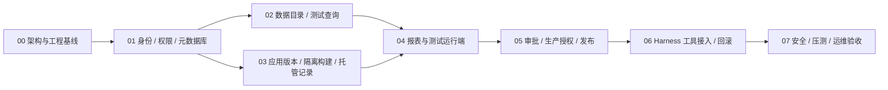

> 阶段06实现更新：顺序审批、冻结清单、受控静态部署、生产授权与重新审批回滚见 [上线发布说明](releases-guide.md)、[验证范围](stage06-validation.md) 和 ADR0021。下文旧阶段记录保留为历史，当前实现以这些说明和 OpenAPI 为准。

> 阶段03实现与当前后续顺序：统一网关、权限/行过滤/脱敏/导出/取消/成本门和真实PG测试已落地。先完成企业OIDC、mTLS/Vault、数据库网络区、角色权限和成本阈值调优，再实现报表编辑/批准查询快照生产者、审批与部署/runtime_grant签发。MySQL/SQLServer网关在等价会话/成本/取消与真实实例验收前保持关闭。旧preview安全旁路已关闭，不应恢复。


> 当前阶段02已实现，验收状态见stage02-validation.md。原计划中的“下一阶段”以本节为当前排序。

## 当前与下一步

1. 已实现数据目录、TEST/PROD映射管理、独立connector、不可变语义、字段/指标授权、真实TEST预览和实际API管理UI。
2. PostgreSQL18.4本机真实集成通过；MySQL/SQL Server需为对应引擎提供真实只读测试实例，实测连接、TLS、元数据、超时和字段类型。没有实例时保持待实测，不修改状态掩盖。
3. 企业环境完成OIDC/JWKS/MFA、Vault ACL、mTLS双向证书、TEST/PROD不同网络区、撤权/秘密轮换/worker宕机与恢复演练。当前身份生命周期同步和浏览器PKCE登录尚待补齐。
4. 下一业务阶段先做报表声明式查询/用户行策略与独立运行身份，再做审批快照、生产runtime_grants与发布/回滚；全部通过服务端实时授权。不能从本阶段连接健康管理开放生产业务查询。
5. 应用生成、构建沙箱、制品签名/扫描、部署代理、Cordis业务工具留给对应阶段。严禁控制面执行AI源码。

本次不会删除既有阶段00设计；新增迁移和ADR记录实际变更。阶段02默认pnpm check包含原生真实PG、API HTTP、独立worker子进程和UI构建；浏览器操作记录另列，未自动化浏览器回归不混入单元测试数字。

# 开发阶段与验收计划

## 1. 阶段依赖



阶段号是交付顺序，不是工期承诺。每阶段先满足入口条件，再完成可演示闭环和拒绝测试；不把生产连接作为测试查询失败的补偿措施。

## 2. 分阶段工作与完成定义

| 阶段 | 入口与实现内容 | 必须通过的验收 | 交付证据 |
| --- | --- | --- | --- |
| 00 架构基线 | 空仓库；完成架构、实体、接口、安全、ADR、工程骨架 | 冻结锁文件可安装；8 包 strict 检查/构建；OpenAPI；参考 DDL；关闭业务执行 | 当前文档、配置、类型、检查脚本 |
| 01 身份权限 | 企业 OIDC 测试租户、PostgreSQL 18 | JWT issuer/aud/exp/撤销；两组织隔离；RBAC 与资源授权；RLS 默认拒绝；管理员授权上限；幂等/审计/outbox | 版本化迁移、权限种子、身份集成测试、管理界面首屏 |
| 02 数据目录 | 阶段01；两个相互隔离的模拟业务源、测试 Vault | 逻辑/物理映射、schema 版本、字段/指标、SSRF 验证、参数化编译、只读/限额/取消；测试身份无法接生产 | 目录维护与测试查询闭环、攻击语料、网络拒绝证据 |
| 03 应用构建 | 阶段01；对象存储、专用 Linux 构建主机与沙箱 | 上传限制、不可变版本、模板锁、依赖脚本禁用、无网络构建、签名/扫描、预览隔离；托管 CRUD 按 owner/org/env 鉴权 | 应用源码→预览；恶意源码测试；平台记录演示 |
| 04 报表运行端 | 阶段02/03；声明式 schema 和图表编译器 | 报表依赖归一化、queryKey 固定、配置无脚本；当前访问者行权限；缓存隔离；权限撤销后不可读旧结果 | 表格/柱/线/饼/指标测试报表、ECharts 安全适配器 |
| 05 审批发布 | 测试链路完整；企业审批策略/数据负责人、生产查询池 | 独立审批、快照完整、不可自审、生产 grant 服务端创建、版本/映射变更失效、原子 slot、重复任务与故障恢复 | 审批→生产只读查询闭环、失败注入及并发测试 |
| 06 Harness / 回滚 | 阶段05；固定 Harness release 与实际企业宿主 | 真实 Cordis 挂载/卸载、用户身份委托、工具 schema、取消/重试；插件不可审批；历史制品新申请回滚且权限不复活 | 插件包、宿主版本锁定、端到端应用与报表演示 |
| 07 上线验收 | 各功能闭环；隔离环境、安全团队和运维参与 | 逃逸/SSRF/凭据扫描；撤销时效；并发与源库负载；备份恢复；监控告警；制品 SBOM/签名与漏洞处理 | 安全报告、压测报告、运行手册、恢复演练记录 |

## 3. 推荐实现顺序

先实现可复用的 Subject/OrganizationContext、AuthorizePort、AuditPort、IdempotencyStore、Outbox 和事务封装。开发授权服务时就建立两组织、两开发者、不同部门浏览者、独立审批人、数据负责人和发布者的真实测试样本，禁止使用全局管理员作为唯一测试账号。

查询编译器先只支持 PostgreSQL 单视图、预定义字段/指标、有限比较和分组，先做拒绝语料再开放查询。MySQL、SQL Server、跨库 JOIN、用户函数与自然语言 SQL 不在首版接口中；扩展须单独 ADR 与查询计划审查。查询 worker 同一代码按固定身份分开部署，队列消息不能动态切环境。

构建只接受固定 React 模板，平台维护的锁文件与依赖镜像；不开放任意 build command。制品不可变后再接入审批，避免一边设计审批一边让产物被覆盖。托管记录以 JSON Schema 子集和安全行策略实现，避免提前生成任意业务后端。

最后接 Harness 的业务工具，保证平台 API 可独立集成测试。建议工具：studio_list_datasets、studio_create_app、studio_create_app_version、studio_build、studio_create_report_version、studio_query_test、studio_submit_release、studio_get_job。不存在 studio_approve_release 或 studio_connect_production 工具。工具名称和参数从已稳定接口派生；用户身份由宿主会话桥提供，不进入模型参数。

## 4. 阶段 00 当前工程内容

- 两个 React 页面为可构建入口，仅呈现平台/报表运行端状态，无业务按钮或假成功数据。
- NestJS/Fastify 提供 liveness；readiness 返回503；任何未实现业务路径返回404。
- shared 提供环境和值类型，contract 提供完整设计与生成类型。
- Cordis 插件使用真实 `@deepseek-ai/cordis@4.0.5` 的 apply/provide 生命周期，仅提供关闭执行的能力描述；尚未注册业务工具、身份桥或远程请求。
- query/build worker 可编译并运行，输出禁用能力后正常退出，不启动队列消费者、不连接数据源、不创建沙箱。生产 worker 配置尚未提供。
- Compose 仅提供本地依赖及可选 API；参考 DDL 显式执行验证，不自动初始化生产库。

## 5. 后续编码的接口与数据规则

OpenAPI 是对外契约源，业务实现须为请求建立运行时 schema 校验；TypeScript 生成类型不会在运行时拒绝恶意 JSON。内部任务协议需另外定义 claim/lease/complete/cancel 及工作负载身份受众，不能将计划中的内部路由悄悄暴露给用户。

先把 `docs/schema.sql` 转为首个迁移并补齐数据库角色、RLS、immutable 保护和权限种子，加入真实 PostgreSQL 18 CI。引用关系必须保留 organization_id 复合约束；本阶段约束验证不覆盖状态机。数据库与 REST 命名变更必须同时更新 schema、契约、设计与测试。

阶段05之前必须冻结：审批策略来源、required reviewers 与数据 owner 映射、生产只读视图清单、schema digest 计算方式、最大数据范围、Vault 命名空间、网络允许矩阵和撤销时效。缺少这些企业配置时继续完成模拟环境测试，生产执行保持关闭。

## 6. 执行验证

```sh
pnpm install --frozen-lockfile
pnpm check
```

`check` 顺序为契约校验、包边界检查、交付文档与 YAML 检查、类型检查、所有包构建、参考数据库验证和骨架行为测试。类型检查会先构建 shared/api-contract 以解析 workspace 导出；从全新克隆可执行，无需手工创建 dist。构建不会启动 Docker、业务数据库或完整 Harness。

Docker 可用时另行执行：

```sh
pnpm env:init
docker compose --env-file .env -f infra/compose.yaml config --quiet
pnpm infra:up
```

宿主没有 Docker 的情况下，不能把这些命令的文档示例当作运行成功证据。生产网络、Vault、真实 Harness 宿主加载和沙箱实测是明确保留的后续验收项。

## 7. 需求到设计的追踪

| 目标 | 设计落点 | 后续主要验收阶段 |
| --- | --- | --- |
| AI 轻应用 | architecture §4/6.1；AppVersion / Collections；Applications API | 03、06 |
| 授权报表 | ReportVersion / QuerySpec；viewer 与 runtime_grant 相交 | 02、04、05 |
| 测试/生产逻辑映射 | source_mappings、mapping_heads、环境复合 FK | 02、05 |
| 开发仅测试 | /queries/test 与 preview 固定 test、网络/秘密分区 | 02、03 |
| 审批后受限生产读取 | release_scopes、approval_records、runtime_grants | 05 |
| 版本/部署/回滚 | app/report/dataset 版本、deployment_slots、新回滚申请 | 03、05、06 |
| RBAC 和资源权限 | role_bindings/resource_grants/current viewer/组织上下文 | 01、04、05 |
| 风险与隔离 | security-design 风险矩阵及阻断条件 | 各阶段、07 |
> 本次按用户阶段04/05新需求交付：实际Studio应用/报表/源码版本、独立固定编译、当前访问者TEST查询、React/ECharts运行组件与Harness桥接插件。后端不新增模型生成服务。当前真实PG/编译/浏览器验证见stage04-05-validation；Harness加载、工具和确认按用户要求由用户测试。下一阶段06实现独立审批、签名扫描、正式构建沙箱与生产授权签发；阶段07扩展Sites托管写能力、协作、完整分页、对象存储与部署运维，不能让现有preview_only制品进入生产。

