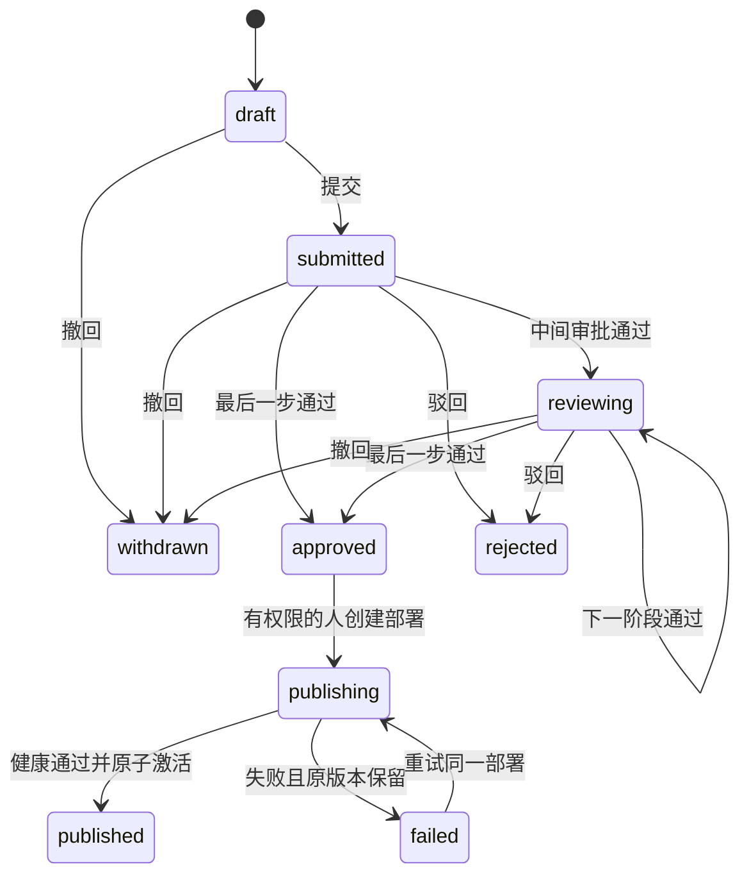

# 上线审批与正式发布

当前支持静态 React 业务网站及报表源码版本，从 TEST 测试到审批、生产授权、正式运行和重新审批回滚。正式页面使用同一个查询网关，AI和浏览器不接触生产数据库凭据。查询行数与排队方式继续遵循现有按请求取数、后台排队规则；本阶段未增加申请次数、图表数量或查询数量配额。

## 使用流程

1. 开发者在原服务器工作区修改源码，提交版本、构建并完成真实TEST预览。已提交源码、报表和数据集版本不修改。
2. 在站点详情点击「申请上线」，或在「上线发布」新建申请。在同一张申请表内选择审批人；可以添加、删除和上下移动审批阶段。没有先去其他页面配置流程的前置要求。同一人可以承担多个阶段，实际审核人始终从其登录会话确定。
3. 在申请表选择源码版本，查看真实构建状态；尚未构建的版本可以就地「构建并预览」，也可以点击「构建并提交审批」完成固定编译后提交。填写业务说明、真实测试结果、使用部门与成员；界面根据版本查询和语义模型生成字段、指标与敏感字段声明。已存在的应用流程仅作为可修改的表单预填内容。
4. 审批人在「待我审批」查看冻结版本、源码变更路径、测试说明、数据范围和清单摘要，填写意见后同意或驳回。服务端从当前登录会话取审批人，未知身份字段会被拒绝。后续阶段不能提前审核。
5. 全部通过后，有release.deploy权限的人点击「发布到生产」。后台校验、读取生产真实元数据、准备固定产物、读回健康检查，再一次性授予本次部署的访问范围并激活。失败保留原正式站点；恢复依赖后重试相同任务。
6. 正式站点位于门户 `/p/{appId}`。需登录；每次查询交集当前用户权限、当前部门/行策略、批准scope和有效runtime grant。TEST分享链接 `/s/{shareId}` 继续固定TEST版本，不会自动转生产。
7. 「发布历史」选择历史部署，填写回滚原因和目标版本在当前权限下的测试结果。系统创建新的回滚申请，重新审批和发布；不回滚外部数据库数据。

申请草稿一经创建就冻结提交内容，不提供悄悄替换版本/数据范围的修改接口。填写错误可撤回后创建新申请。所有内容哈希、审批意见、部署阶段、错误码、操作者和Trace ID保留；查询审计通过query_job.deployment_id关联同一部署和release_request。

申请和审批只需要有效的源码构建、逻辑数据集、已授权字段/指标以及版本化结构；不要求提前配置物理生产连接。审批冻结expectedSchema和数据范围，release_scopes.mapping_id此时可以为空。点击实际发布时，后台读取管理员配置的生产映射，核对批准结构，把映射写入不可变deployments.mapping_snapshot。每个生产运行授权必须与该部署绑定的生产映射相符，数据库触发器也执行此关联校验；客户端仍不能指定连接或把TEST映射当成生产映射。旧申请已经冻结的物理映射继续按原事实校验，不改写历史。

缺少生产映射只影响实际发布，返回PRODUCTION_MAPPING_NOT_CONFIGURED及对应数据集名称。创建申请不会因此返回NOT_FOUND。网页与插件保留API明确返回的业务原因、具体字段和处理方法，不用通用错误码文案覆盖；源码丢失、构建产物缺失、数据集停用、缺少TEST授权、目标成员未获数据读取权限分别使用不同错误码。

## 状态与合法转换



界面对应待提交、待审核、审核中、审批通过、审批驳回、已撤回、发布中、发布成功、发布失败。相同Idempotency-Key重放原结果前重新鉴权；不同Key的重复发布也复用同一个release对应的deployment。审批按stepIndex唯一记录。重新执行不会重复增加正式部署或签发多份运行授权。

## 后台配置

平台API使用DEPLOY_WORKER_URL/KEY和DEPLOY_CLIENT_TLS_CERT/KEY/CA配置部署服务。服务启动：

```sh
pnpm --filter @eas/deployment-worker build
node services/deployment-worker/dist/main.js
```

部署服务需要DEPLOY_WORKER_KEY、DEPLOY_ARTIFACT_DIR、DEPLOY_WORKER_PORT、DEPLOY_TLS_CERT/KEY/CA。DEPLOY_WORKER_HOST默认127.0.0.1，容器部署可配置0.0.0.0。正式配置强制mTLS和签名消息。NODE_ENV=test且显式DEPLOY_ALLOW_LOCAL=true仅允许本机回环访问，不能作为企业部署指南中的TLS替代。

生产查询服务继续使用CATALOG_PRODUCTION_URL/KEY、CATALOG_CLIENT_TLS_*和API_SERVER_TLS_*。生产connector使用独立环境、网络端点与最小只读账号，配置CATALOG_SERVER_TLS_*及CATALOG_CLIENT_TLS_*。证书可来自现有Vault提供器；单一挂载CA可用CATALOG_DATABASE_CA_FILE，并把端点caRef设为configured:database-ca，路径仅来自运维配置，不来自用户请求。

本机 `pnpm dev:local` 启动固定构建与静态部署服务，仍不创建或猜测企业生产连接。界面标明生产数据运行服务是否配置。正式数据发布需要运维配置生产connector和TLS；没有配置时部署明确失败，不签发虚假授权。现有运行数据不会被重新初始化。

## API

所有接口以`/v1`为前缀，写操作带Idempotency-Key；Cookie请求另带CSRF。唯一契约为packages/api-contract/openapi.json。

| 接口 | 权限与用途 |
| --- | --- |
| GET /release-options | release.read；组织成员、可审批成员、可配置应用和执行服务状态 |
| GET/POST /release-requests | release.read / release.create；可见申请列表、创建冻结草稿 |
| GET /release-requests/{id} | 当前申请人、指定审批人或发布管理人员 |
| POST /release-requests/{id}/submit | 申请人提交当前有效版本 |
| POST /release-requests/{id}/cancel | 申请人在可撤回状态撤回 |
| POST /release-requests/{id}/approvals | 人类release.approve；stepIndex、decision、comment |
| GET /release-requests/{id}/approvals | 查看同一冻结申请与意见 |
| GET/PUT /apps/{id}/release-policy | release.read / 人类release.policy.manage；顺序审批设置 |
| POST /release-requests/{id}/deployments | 人类release.deploy；仅已批准申请 |
| GET /deployments/{id} | 状态、phase、attempt、failureCode、Trace ID与事件 |
| POST /deployments/{id}/retry | 人类release.deploy；失败后重新验证，同任务恢复 |
| GET /apps/{id}/deployments | 可访问申请对应的发布历史 |
| POST /apps/{id}/rollback-requests | 当前维护者创建历史版本的新审批 |
| GET /runtime/apps/{id}/site | 当前受众及app.view；正式静态产物 |
| POST /runtime/apps/{id}/bound-queries | 当前生产数据权限；queryKey绑定冻结版本 |

提交体包括appVersionId、buildJobId、reason、testResults、targetDepartments、audienceUserIds、scopes及approvalSteps。approvalSteps是本次申请的路由选择，包含roleKey、label、approverUserId；服务器验证所选人员属于当前组织、在职且具备当前审批权限，随后把顺序与人员冻结到申请。它不代表当前操作者的审核身份；审批接口仍只接受stepIndex、decision、comment，拒绝客户端伪造审核人。旧客户端省略approvalSteps时兼容已有应用流程；新界面不依赖它。scope包括datasetVersionId、fieldKeys、metricKeys、sensitiveFieldKeys，可选maxRows；省略或null不增加行数上限。服务器选择生产mapping和当前语义策略，不接受host、密码或环境选择。

## Harness

插件0.2.1提供enterprise_release_options列出可选审批人，enterprise_release_submit按用户选择提交申请，enterprise_release_status查询状态；enterprise_deployment_status可查buildId或deploymentId。AI可整理材料和提交，不能审批或部署。原生站点页提供门户审批入口。真实Harness宿主验证按用户既有要求由用户执行，后端集成测试不冒充宿主验收。

## 当前范围

受控部署适用于固定React静态HTML，工作进程不执行项目脚本。opaque iframe与CSP用于浏览器隔离，数据库由网关访问；独立部署服务的落盘与摘要健康检查不等于通用服务端沙箱或漏洞扫描认证。MySQL/SQLServer生产查询仍未有真实实例验收。对象存储、多节点制品分发、企业PKI轮换、OIDC/MFA/Vault接入和压测恢复需在企业环境继续验收。

通用报表组件通过SDK的getRuntimeContext读取显示环境，正式页面显示PROD。该值仅控制文案，不能选择数据库或授予权限。旧的不可变构建不会被后台改写；源码中自行写死TEST的旧页面需要修改源码后提交新版本。
